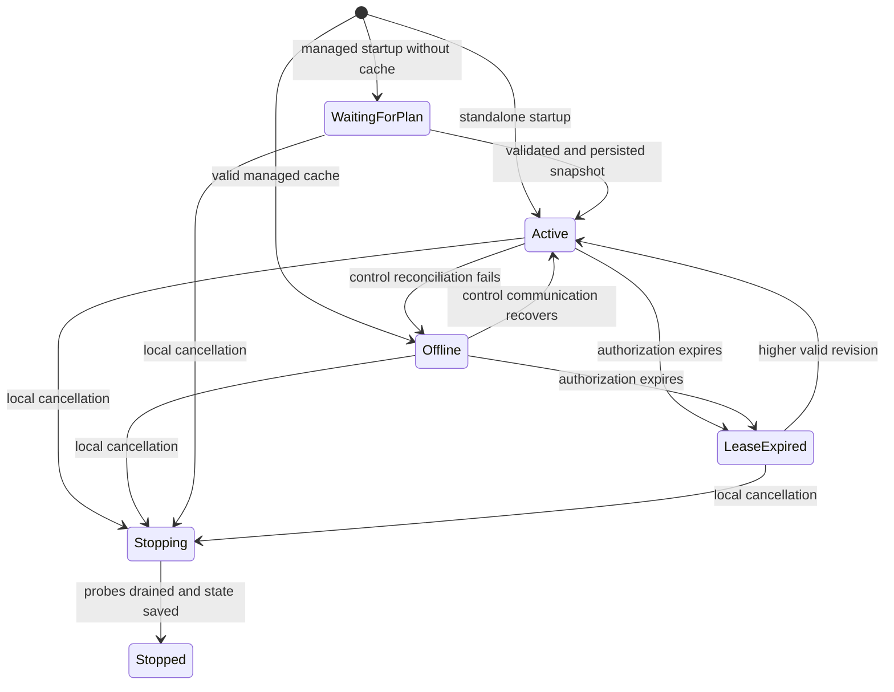

# Agent architecture

Pulse is a single Rust 2024 package with a thin Tokio current-thread executable.
The agent executes monitoring plans autonomously; control planes orchestrate which
checks belong on which agents. The BSD-3-Clause agent has no dependency on the
proprietary Cloud implementation, subscriptions or accounts for standalone use.

## Implemented slice and ownership

The agent runs standalone HTTP monitoring and an HTTPS managed flow tested
against a compatible local server. The public protocol remains a draft. There are no placeholder
successes, remote shell operations, collectors, brokers or generated servers.

| Component | Responsibility |
| --- | --- |
| `cli/` | clap builders, pure typed dispatch, action execution and diagnostic lifetime |
| `config/` | strict bounded TOML, local hard limits, URL/HTTP policy validation |
| `agent/` | state machine, atomic plan activation, owned tasks, shutdown and community policy |
| `scheduler.rs` | monotonic heap of recurring assignment deadlines |
| `governor.rs` | shared admission, rate/concurrency/connection/memory reservations and body budget |
| `probe/` | GET/HEAD, manual redirects, verified TLS and pinned DNS policy |
| `protocol/` | typed full plans, recipes, credentials and short-lived commands |
| `observation.rs` | native typed outcomes, correlation, optional measurements and health |
| `transport.rs` | HTTPS client, JSON control, Protobuf batches and capped retry backoff |
| `storage.rs` | private SQLite state, run lock, last-known-good plan, spool and command deduplication |

Collectors will sample independently of probes. Additional engines should consume
the same admission permits, deadlines and observation types. Introduce new modules
when implemented, without a multi-crate workspace or generalized plugin framework.

## Operating modes and state machine

Standalone mode uses local definitions and requires explicit stdout output. Managed
mode requires enrollment into the configured state directory, then accepts only its
assigned subset of monitors. It rejects local probe definitions. Community work is
a managed capability with a separate local opt-in and stricter budgets; it cannot
change the provisioned identity or gain private-network access.

These are executor states, not incident judgments. Health reports no host metrics.
Connection health is sampled; an offline transition can lag a failed request.
`status` checks a local exclusive lock for liveness and reads checkpointed counters.

Only one run/enrollment action holds the state lock. Credential recovery must use
the same control-plane issuer and agent ID; it preserves observations and revision
history. Deployment identity comes from trusted provisioning on the enrollment
service, never a CLI role flag. Renewals cannot change identity or deployment.

## Configuration and authorization

Local TOML owns security policy and resource ceilings. Remote recipes supply probe
specifications within those ceilings. Parse limits are enforced before buffering:
configuration and full plans are at most 1 MiB. Unknown fields, duplicate IDs,
invalid targets, missing recipes, invalid timeouts and incompatible modes fail.
Identifiers are bounded ASCII letters, digits, `_` and `-`.

Managed snapshots have an agent-specific increasing revision, immutable assignment
identity, explicit epoch, phase and expiry. Validation completes before durable
replacement; old tasks are cancelled only after the complete replacement is saved.
Rejected updates retain the last accepted plan. A revision cannot change content
or extend its lease in place; use a higher revision. Adjacent snapshots cannot
reuse an assignment ID for a different monitor/target. Servers must never reuse
retired IDs: the client does not retain an unlimited historical ID registry.

An expired cached plan retains its revision for rollback protection but cannot
execute. A `304` carries no renewal. On activation, the remaining UTC lease becomes
a monotonic deadline; forward wall-clock jumps also expire work. Restart uses the
persisted absolute expiry. Correct UTC and protected local state are required;
rollback-resistant authorization across hostile clock changes remains a rollout
decision. Long-lived work cannot outlive the accepted plan lease.

Local file changes take effect on restart. Community enable/disable is a persisted
local override, observed every second. Disable cancels active community work;
it cannot stop ordinary customer monitoring or raise limits. Configuration fields
for logging remain reserved: CLI flags and `RUST_LOG` own diagnostics today.

## Scheduling and scale

A binary heap holds one deadline per assignment. One actor owns the heap and a
bounded `JoinSet`; there is no timer task, channel or background loop per target.
Deadlines follow `epoch + n * interval + phase + stable_jitter` and are translated
once to monotonic time on activation. Stable positive jitter is limited to 5% of
the interval; phase plus jitter must stay within that interval. Omitted standalone
phases are deterministically spread by ID; managed offsets are explicit.

Late wakeups count missed cycles and advance directly beyond the current time.
Only the latest due occurrence is eligible, with no accumulated queue. A recurring
assignment cannot overlap itself. Saturated/rate-limited work is skipped, never
retried as a catch-up job. Intentionally identical phases can therefore starve
some assignments: the control plane must spread load across the interval, rather
than assigning every monitor the same base phase.

The proposed managed product baseline is three locations per endpoint every
300 seconds, with geographic offsets such as 0/100/200 seconds. Each agent runs
only its own assignment once per cycle and need not know other locations. With
20 edge agents and 1,000 endpoints, this is about 150 assignments and 0.5 checks/s
per edge. Neither three replicas nor 300 seconds is hard-coded into the agent.
Standalone intervals are configurable within local policy.

## Resource governance

Admission happens before task creation. Routine, urgent and community work share
one governor. Routine work leaves configured capacity for urgent work; urgency
cannot bypass global rate, connection, memory or community policy. No waiting
probe queue is created. RAII permits release capacity on every exit path.

Effective concurrency is the minimum of:

- `max_concurrent_probes`;
- `(max_connections - control_reservation) / 2` (three reserved in managed mode);
- `max_probe_memory_bytes / 4194304` (a conservative accounting reservation).

Two socket slots per probe account for dual-family connection races. Three control
slots cover one reconciliation request, one long-poll and one retained idle
connection. Probe idle pools are disabled, avoiding a cache per discovered target.
This is a TCP-client accounting model, not a count of resolver, OTLP or kernel
resources. Memory reservations are not allocator/RSS guarantees. Use OS/cgroup
CPU, RSS, FD and task limits for hard host containment.

| Local setting | Default | Accepted range / meaning |
| --- | --- | --- |
| `max_concurrent_probes` | 4 | 1..256; no greater than max_checks |
| `max_checks` | 1024 | 1..4096 |
| `min_interval_ms` | 1000 | 1000..86400000 |
| `max_timeout_ms` | 10000 | 1..300000; each timeout also <= interval |
| `max_result_bytes` | 65536 | 1024..1048576; maximum retained encoded observation |
| `max_probe_starts_per_second` | 5 | 1..1000; evenly spaced starts, no burst reservoir |
| `max_connections` | 8 | 2..256; managed requires >=5 |
| `max_probe_memory_bytes` | 16777216 | 4194304..1073741824; admission accounting |
| `max_response_bytes` | 32768 | 1..1048576; inspected body prefix |
| `max_bytes_per_second` | 1048576 | 1024..16777216; shared inspected body bytes |
| `max_buffered_observations` | 256 | 1..4096; local output count |
| `max_spool_mb` | 32 | 1..256 MiB; persistent storage budget |
| `reserved_urgent_probes` | 1 | below configured concurrency; adjusted to effective capacity |
| `max_plan_lease_ms` | 86400000 | 1000..604800000 |

`[resources]` aliases `[limits]`; supplying both is rejected. Community defaults to
one active probe and 60 evenly spaced starts/hour, within global ceilings. Its
hourly limit is 1..3600 and concurrency cannot exceed the main limit.

The body-byte budget measures inspected application payload, not all inbound wire
traffic. TCP/TLS buffering, response headers, retransmissions and requests still
consume bandwidth. A deadline, start rate, 16 KiB HTTP/2 header limit and bounded
HTTP/2 flow-control windows constrain exposure; kernel traffic shaping is needed
for a strict host-wide network ceiling. These limits are not permission to use
unrestricted memory on routing-critical hosts.

## HTTP execution and measurement semantics

The engine accepts HTTP/HTTPS GET/HEAD without arbitrary headers, credentials,
request bodies or scripts. TLS verifies certificates and hostnames with WebPKI
roots or an explicitly supplied CA. Ambient proxies are disabled. Redirects are
manual, limited to five, revalidated at every hop, and cannot downgrade HTTPS.

DNS resolution checks every answer (at most 16) before handing those exact
addresses to the connector. Mixed public/private answers are rejected for public
work. Literal addresses receive the same policy. Public work rejects private,
loopback, reserved, translation/tunnelling ranges and metadata addresses. Private
probing requires explicit local permission and a private deployment identity;
metadata and link-local addresses remain forbidden. DNS names are resolved by
a shared pool of at most eight blocking libc jobs (also capped by effective probe
capacity), with permits retained through timeout. This prevents
unbounded resolver work; libc resolution itself cannot be cancelled.

A single total deadline covers DNS, connection, TLS, redirects and optional body
inspection, shortened by command deadline and lease. Cancellation yields SKIPPED.
Inspection reads a capped streamed prefix and never stores response content.
Status policy yields PASS or FAIL. Transport/timeout failures yield ERROR;
local policy refusal yields SKIPPED. Admission/missed-work refusals increment
health counters without producing a flood of per-refusal observations.

Observations contain UTC start/completion, monotonic total microseconds, HTTP
status, final peer address when available, redirect count, inspected bytes,
content-length and truncation information. For HEAD, content-length describes a
representation, not transferred bytes. When inspection is disabled, total duration
ends after response headers; with inspection it includes the inspected prefix.
DNS/TCP/TLS/TTFB fields remain absent because this client cannot measure them
precisely. Scheduler delay is not endpoint latency. No phase uses invented zeroes.

## Native observations and persistence

Native messages are independent of diagnostic OpenTelemetry. UUID observation IDs
remain stable across retries. Provenance distinguishes routine, Live Check,
community and manual work. Correlation IDs survive command execution and upload.

SQLite with bundled bindings was chosen over an append-only spool: it supplies
atomic plan/credential replacement, observation acknowledgements and command
reservation in one small local database. An append log would need additional
indexes, crash recovery and bounded compaction to provide the same guarantees.
The trade-offs are a larger binary, synchronous durable writes and dependency
maintenance. There is no separate database service.

SQLite runs behind a serialized `spawn_blocking` boundary, with a 512 KiB cache,
DELETE journaling, synchronous EXTRA, private files and no shared mutable lock held
across await. The main database is capped to a third of the storage budget, leaving
journal/headroom; retained observation payloads use at most a quarter of that
budget. A transactional byte counter makes per-record admission constant-time.
Each record is capped by max_result_bytes and the wire batch ceiling, command deduplication has at most 1,024 entries and expired
entries are reclaimed. Filesystem metadata/temporary overhead and an exhausted
underlying disk still require operational headroom. Fatal persistence errors stop
the executor; SQLite-full or logical spool-full drops newest records and increments
loss counters. Old unacknowledged records are preserved.

Uploads contain at most 64 records and 256 KiB including Protobuf framing.
Only exact IDs in a validated durable acknowledgement are deleted transactionally.
HTTP success alone does not delete anything. Lost replies retry unchanged IDs;
compatible servers must deduplicate by authenticated agent plus observation ID.
At-least-once delivery applies to durably retained records, not to overflow loss,
local stdout, or a measurement interrupted before persistence.

State directories must be owner-only (`0700`) and files `0600`. Symlinks and
unexpected ownership/permissions are rejected. State is not encrypted; filesystem
and backup access must protect credentials. Use trusted parent directories and a
local filesystem with working locks/fsync. Future database versions are rejected
rather than modified blindly. Local status, community controls and credential
recovery open existing metadata without reapplying default spool budgets or
changing the executor's storage ceiling. Measurement writes require explicitly
configured spool limits.

## Control and Live Checks

HTTPS control uses one origin, strict timeouts, explicit custom roots, no proxy,
no credential redirects, JSON configuration and native Protobuf upload. A separate
control task cannot block the scheduler. Updates use an eight-slot channel;
notifications coalesce into one slot. Reconciliation and uploads run at most once
per second, ordinary plan/work polling defaults to 30 seconds, health to 30 seconds.
Long-poll waits 25 seconds with a 30-second client deadline. Failures back off with
jitter to at most 36 seconds; immediate responses are throttled. Polling alone can
be selected for private/community installations.

Events are hints. Durable work is fetched separately, validated against the active
revision/assignment, admitted, and reserved locally before claiming. Only an
explicit successful claim starts a probe. Live priority can use reserved slots,
while community Live work retains community limits. Command deadlines are at most
one minute. Duplicate IDs do not spend probe-rate capacity. Cancellation tombstones
cancel matching active command/run pairs; new plans and lease expiry cancel old
work. Local opt-out cancels community work.

A crash after reservation has an uncertain network outcome. Recovery emits ERROR
`execution_interrupted_outcome_unknown` with the reserved observation ID and does
not re-execute the command. A lost claim response produces SKIPPED. This chooses
at-most-once accepted execution over pretending to provide exactly-once probes.
Servers must retain terminal command state through expiry and never resurrect IDs.
Commercial Live Check quotas and multi-region incident decisions belong to Cloud.

## Shutdown and deployment

SIGINT/SIGTERM cancels control requests and active probes, drains owned tasks,
persists results and final health, then flushes/shuts down optional diagnostic
providers while Tokio is still alive. Output uses a bounded queue and a one-second
shutdown drain; blocked Linux pipes/sockets cannot prevent termination. Partial
output may be discarded and is counted. Filesystem writes and libc DNS depend on
OS behavior and can still delay shutdown; they are not cancellation-safe services.

Run the binary as an unprivileged service user. For systemd, set WorkingDirectory,
a private writable StateDirectory, ExecStart with an absolute configuration path,
KillSignal=SIGTERM, NoNewPrivileges=true and suitable MemoryMax/CPUQuota/LimitNOFILE.
Containers use the same binary and an owner-only state volume; no inbound ports or
privileged capabilities are needed. No deployment pipeline is included.

## Verification and remaining rollout decisions

Deterministic scheduler/governor tests cover phase anchoring, stable jitter,
4,096 assignments, missed cycles, admission and resource release. Local verified
HTTPS integration tests cover enrollment, renew/recovery, revisions, offline
restart, lease expiry including 304, duplicate/lost acknowledgements, Live Checks,
cancellation, community policy, TLS/network restrictions and blocked-output exit.
The fixture is not a production backend. See [PROTOCOL.md](PROTOCOL.md).

Before production rollout, settle and validate:

- Public protocol compatibility/version negotiation, credential scopes/revocation,
  enrollment replay recovery and bounded renewal grace on the real control plane.
- Accurate phase measurements if needed; cancellable DNS without relaxing rebinding
  protection; strict host-level CPU/RSS/bandwidth containment and DNS egress policy.
- Longer outage/timeout/load soak tests on the actual BGP hardware and filesystem,
  including power loss, full physical disks, HTTP/2 adversarial peers and clock jumps.
- Permanent invalid-record rejection/dead-letter policy and spool migrations; current
  poison batches remain queued until server acceptance or operator intervention.
- Stronger authorization under clock rollback/reboot and tamper-resistant local
  state if hostile host users are in scope.
- Target/recipe lifetime rules, result retention/deduplication periods and command
  fairness/admission feedback at fleet scale; current refusals use bounded counters.
- Optional exporters, accurate host collectors, additional probe protocols and a
  community scheduler/credit economy. None belongs in a generic remote job runner.
