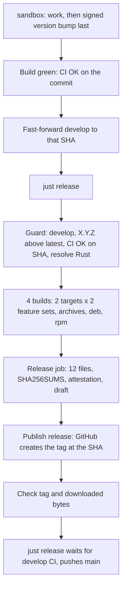

# CI and releases

Pulse uses reusable GitHub Actions workflows and small local actions with read-only
repository access. Only the final GitHub release job receives `contents: write`.
External actions are pinned to commit SHAs; version comments identify the corresponding
upstream refs. Build is the single pull-request entry point, so tests, coverage and
audit run once while every architecture/feature combination also exercises native
packaging. Its aggregate `CI OK` job (tests, audit and the four builds) is the check
that branch protection and the release guard require; coverage is reported but does not
gate.

| Workflow | Trigger and responsibility |
| --- | --- |
| `test.yml` | Manual runs or reuse: formatting, both feature sets, strict Clippy, tests and Rust 1.88 |
| `coverage.yml` | Manual runs or reuse: all-feature LCOV report and a retained coverage artifact |
| `security-audit.yml` | Daily, manual runs, or reuse: audit the tracked lockfile |
| `build.yml` | Pull requests, pushes to main, develop and sandbox, manual runs: tests/coverage/audit, the four native builds and packages, then `CI OK` |
| `release.yml` | Manual run on `develop` (`just release`): guard, the four builds, checksums, attestation and the GitHub release that creates the tag |

The local actions `build-package` (build, smoke-test and package one target and feature
set, used by both `build.yml` and `release.yml`), `rust-toolchain` and `crate-info`
live in `.github/actions`.

Coverage uses `cargo-llvm-cov`, matching `just coverage`. Its LCOV artifact is
available for 14 days without external service credentials. To also upload to
Codecov, configure the optional repository secret `CODECOV_TOKEN`; only the upload
step receives it. Fork pull requests without that secret still produce coverage.
There is no coverage percentage threshold. The dependency audit fails on known
vulnerabilities and advisory warnings, including optional and development packages.

## Linux artifacts

Native x86_64 and ARM64 runners build musl binaries for:

- `x86_64-unknown-linux-musl`
- `aarch64-unknown-linux-musl`

Each target produces a standard binary with telemetry disabled and a separate
opt-in telemetry binary. Each binary is packaged as `.tar.gz`, `.deb` and `.rpm`,
for **12 release files** in total. All use the locked dependencies and release
profile. Both feature sets are smoke-tested with help, short/long version and
validation of both example configurations. Native package payloads are extracted
and checked against the original executable before checksums are generated.
RPM payloads are converted with `rpm2archive` and extracted with `tar`; this also
supports RPM 4.18 when a package omits the optional legacy archive-size tag.
Ordinary main builds retain all files and individual SHA-256 files for 14 days.

| Rust target | Debian architecture | RPM architecture |
| --- | --- | --- |
| `x86_64-unknown-linux-musl` | `amd64` | `x86_64` |
| `aarch64-unknown-linux-musl` | `arm64` | `aarch64` |

| Format | Standard build | Opt-in diagnostic telemetry |
| --- | --- | --- |
| Archive | `pulse-0.1.0-x86_64-unknown-linux-musl.tar.gz` | `pulse-0.1.0-x86_64-unknown-linux-musl-telemetry.tar.gz` |
| Debian | `pulse_0.1.0-1_amd64.deb` | `pulse-telemetry_0.1.0-1_amd64.deb` |
| RPM | `pulse-0.1.0-1.x86_64.rpm` | `pulse-telemetry-0.1.0-1.x86_64.rpm` |

The same three formats are generated for ARM64. Default Cargo features are empty;
standard packages are named `pulse`. The `pulse-telemetry` packages are explicitly
selected alternatives, declare conflicts with the standard package and provide
the same `/usr/bin/pulse`. Diagnostic export remains disabled until an OTLP
endpoint is configured, even in the telemetry variant. Native package metadata is
in Cargo.toml; packaging tools are pinned in the build workflow.

Native packages install only the executable, license, README, security policy and
credential-free examples. They contain no installation scripts, service units,
enrollment credentials or active monitoring configuration. Installation never
starts a service or sends a probe. Examples are in `/usr/share/doc/pulse/examples`;
select and copy/edit a configuration before running the agent. The release helper
rejects a mismatched version, architecture, dynamic binary or feature selection.
This metadata is intended for the verified static musl release path.

Archives also contain the architecture/protocol documentation, public Protobuf
schema and contributor guidelines. The release publishes a combined `SHA256SUMS`
covering all 12 files. With all release files downloaded, run:

```sh
sha256sum --check SHA256SUMS
```

For a single downloaded file, select its matching checksum line. Native package
versions map Cargo prerelease hyphens to `~`, so `0.1.0-rc.1` becomes
`0.1.0~rc.1-1` in DEB and `0.1.0~rc.1` with release `1` in RPM; prereleases sort
before stable versions. Archive names retain the original Cargo version. (The release
workflow itself publishes `X.Y.Z` versions only; the packaging script keeps this
mapping for local builds.)

## Package locally

Use a native Linux host for the target architecture with musl, binutils, Python
3.11+, `dpkg-deb`, `rpm`, `rpm2archive` and GNU tar installed. Install the same
packager versions as CI:

```sh
cargo install cargo-deb --version 3.8.0 --locked
cargo install cargo-generate-rpm --version 0.21.1 --locked
rustup target add x86_64-unknown-linux-musl
cargo build --release --locked --no-default-features --target x86_64-unknown-linux-musl
bash scripts/package-release.sh x86_64-unknown-linux-musl
```

Output defaults to `dist/`. Telemetry is opt-in for both compilation and packaging:

```sh
cargo build --release --locked --no-default-features --features telemetry --target x86_64-unknown-linux-musl
bash scripts/package-release.sh x86_64-unknown-linux-musl telemetry
```

The optional third script argument selects an output directory. The helper reuses
the built binary with `cargo deb --no-build` and `cargo generate-rpm`; it never
rebuilds with a different feature set. Packages are unsigned local-install files;
package signing, APT/DNF repository hosting and container distribution are separate
work. Verify release checksums before installation.

## Create a release

A release is the commit CI already tested, built and published by one workflow run. The
pattern and its rationale are documented in full in the
[cron-when RELEASING.md](https://github.com/nbari/cron-when/blob/main/RELEASING.md);
this section is the short version for Pulse.

1. On `sandbox`, make the last commit of the work the version bump: `package.version`
   in Cargo.toml and Cargo.lock (`cargo set-version --bump patch`). Versions are
   `X.Y.Z`; the release flow does not publish prereleases. Commits must be signed.
2. When **Build** (the `CI OK` check) is green on `sandbox`, fast-forward `develop` to
   that commit and push. Keep `develop` fast-forward only.
3. Run `just release`. It starts `release.yml` on `develop`, follows it, waits for
   `develop`'s own Build run, and then pushes the released commit to `main`.



The guard refuses a run that is not on `develop`, a version that is already tagged or
below the latest release, a `develop` that does not contain `main`, and a commit
without a successful `CI OK`. It also resolves Rust `stable` to one exact version that
every build uses; the release notes end with "Built with Rust X.Y.Z". Nothing is
published before every build has succeeded, and the tag is created only by publishing
the release. If a job fails, fix the cause and use "Re-run failed jobs"; a failure that
needs a code change after the tag exists is released as the next version.

Treat version tags and published assets as immutable. Never push a version tag by hand.

Required repository settings: `main` protected with the `CI OK` check, signed commits,
linear history and no force pushes; a tag ruleset for `[0-9]*.[0-9]*.[0-9]*` that
allows creation but not update or deletion; commits signed with a key registered on
GitHub. The workflow definitions are release code and receive the same review as Rust
changes. Local checks cannot establish these settings.
